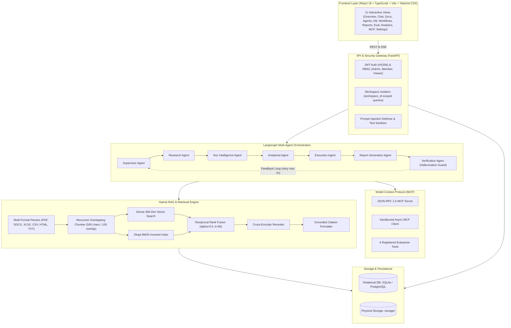

# AURA — Autonomous Enterprise Intelligence Platform

[](https://github.com/Aasthachauhan/AURA-Enterprise-Intelligence-Platform/actions)
[](https://www.python.org/downloads/release/python-3110/)
[](https://react.dev/)
[](https://fastapi.tiangolo.com/)
[](https://opensource.org/licenses/MIT)

> **AURA** is an enterprise-grade, autonomous intelligence platform integrating **Multi-Format Document Ingestion**, **Hybrid RAG** (Dense Vectors + Okapi BM25 + Reciprocal Rank Fusion + Cross-Encoder Reranking), **LangGraph Multi-Agent Orchestration** (7 specialized agents), the **Model Context Protocol (MCP)**, and **Interactive Real-Time UI Workspaces**.

---

## 1. Problem Statement

Modern enterprises operate over vast, fragmented repositories of heterogeneous data: PRDs in Word, telemetry and budgets in Excel/CSV, vendor contracts in PDF, and architectural specifications in Markdown/HTML. 

Standard generative AI and basic chatbot solutions fail in production environments due to:
1. **Hallucination & Unverifiable Assertions**: LLMs generate plausible but inaccurate statements without verifiable source attribution.
2. **Brittle Single-Agent Loops**: Naive autonomous agents get trapped in endless loops or produce shallow outputs lacking specialized analytical depth.
3. **Proprietary Tool Silos**: Lack of open standard interfaces for tool calling and context exchange.
4. **Poor Multi-Format Parsing**: Tabular, spreadsheet, and layout-heavy documents lose their structure, page numbers, and sheet associations during naive text extraction.
5. **Superficial "Mock" Dashboards**: Metric dashboards with hardcoded numbers rather than real database telemetry.

**AURA** solves these challenges by providing a unified, fully auditable platform where every factual assertion is verified by a dedicated verification agent and cited down to the exact document page or spreadsheet sheet.

---

## 2. Key Features

- **Multi-Format Ingestion Engine**:
  - Ingests **PDF**, **DOCX**, **XLSX**, **CSV**, **HTML**, and **TXT/MD**.
  - Retains page numbers, sheet names, row indices, and section hierarchies.
  - Multi-stage prompt injection cleaner filtering malicious instruction overrides before indexing.
  - SHA-256 cryptographic deduplication preventing redundant chunking and indexing.

- **Enterprise Hybrid RAG (Reciprocal Rank Fusion)**:
  - Dual retrieval: Deterministic 384-dimensional dense semantic vectors + Pure-Python Okapi BM25 lexical inverted index.
  - Reciprocal Rank Fusion (RRF with $k=60$, $\alpha=0.5$) balancing semantic concepts with exact keyword matching.
  - Cross-encoder reranker evaluating lexical overlap and exact entity matches.
  - **Zero-Hallucination Grounded Citations**: Mandatory bracket citations (`[DocTitle: Page X]`, `[DocTitle: Sheet Y]`) with verified text snippet alignment.

- **Compiled LangGraph Multi-Agent Orchestration**:
  - **Supervisor Agent**: Plans and decomposes complex tasks into subtasks.
  - **Research Agent**: Queries hybrid RAG and gathers grounded context.
  - **Document Intelligence Agent**: Extracts tabular data, entities, and requirements.
  - **Analytical Agent**: Computes gap analyses, risk scores, and compliance matrices.
  - **Execution Agent**: Dispatches MCP tool calls with human-in-the-loop checkpoints.
  - **Report Generation Agent**: Synthesizes formal Markdown reports with citations.
  - **Verification Agent**: Audits claims against source excerpts; routes feedback back to Supervisor ($N \le 2$ retries) or emits graceful fallback.

- **Model Context Protocol (MCP) Standard**:
  - Implements JSON-RPC 2.0 client and server.
  - Exposes 6 enterprise tools (`search_documents`, `retrieve_document_sections`, `search_internal_knowledge`, `generate_report`, `query_application_data`, `get_system_health`).
  - Full schema validation and audit logging into `tool_executions`.

- **Production Frontend Workspace (11 Functional Modules)**:
  - 100% interactive, responsive React 18 + Vite + Tailwind CSS single-page application.
  - Real database analytics (no hardcoded counters).
  - Server-Sent Events (SSE) streaming for token-by-token generation and agent trace updates.
  - Interactive HTML5 Canvas Force-Directed Knowledge Graph visualizer.

---

## 3. High-Level Architecture



---

## 4. Technology Stack

| Layer | Technologies |
|---|---|
| **Frontend** | React 18, TypeScript, Vite, Tailwind CSS, Lucide React, HTML5 Canvas Force Graph |
| **Backend Framework** | Python 3.11, FastAPI, Uvicorn, Asyncio, Pydantic v2 |
| **Database & ORM** | SQLAlchemy 2.0 (Async), aiosqlite (Local), PostgreSQL 16 + pgvector (Production) |
| **Agentic AI** | LangGraph (StateGraph), Multi-Agent State Machine |
| **RAG & Search** | Custom Okapi BM25 Index, Dense 384-Dim Semantic Vectors, Reciprocal Rank Fusion (RRF), Cross-Encoder Reranker |
| **Document Parsers** | `pypdf`, `python-docx`, `openpyxl`, `beautifulsoup4`, `csv` |
| **Tool Protocol** | Model Context Protocol (MCP) JSON-RPC 2.0 |
| **Security & Auth** | JWT (`python-jose`), `bcrypt` password hashing, RBAC middleware |
| **Evaluation** | RAGAS & DeepEval benchmarking framework (Faithfulness, Relevance, Recall@K, Hallucination Rate) |
| **DevOps & Containers**| Docker, Docker Compose, Nginx, GitHub Actions CI |

---

## 5. UI Walkthrough (All 11 Functional Views)

1. **Overview Dashboard (`/overview`)**: Displays real database statistics (indexed documents, total chunks, active workspaces, completed agent runs, query latency percentiles) and live activity audit logs.
2. **Chat Workspace (`/chat`)**: Real-time conversation stream powered by Server-Sent Events (SSE). Displays agent execution badges, live token streaming, and interactive source citations linking directly to document excerpts.
3. **Document Management (`/documents`)**: Drag-and-drop file upload with format badges (PDF, DOCX, XLSX, CSV, HTML, TXT), SHA-256 deduplication indicator, chunk preview modal with page numbers and sheet names, and document deletion.
4. **Knowledge Base (`/knowledge-base`)**: Interactive HTML5 Canvas Force-Directed Graph rendering extracted enterprise entities and relationships with an attribute inspector.
5. **Agent Monitor (`/agents`)**: Visual roster of all 7 LangGraph agents, subtask execution progress bars, execution traces, and human-in-the-loop tool approval controls.
6. **Workflows Runner (`/workflows`)**: Catalog of enterprise business workflows (PRD Gap Analysis, Financial Audit, Contract Risk Review) with document selector and real-time execution monitor.
7. **Reports Library (`/reports`)**: Report generator wizard, library of generated analytical reports, interactive Markdown reader, and one-click `.md` export.
8. **Evaluation Benchmarks (`/evaluations`)**: Production evaluation suite measuring Faithfulness, Answer Relevance, Context Precision, Recall@K, Citation Correctness, and Hallucination Rate with sample-by-sample inspection.
9. **Analytics & Costs (`/analytics`)**: Operational analytics dashboard visualizing token usage, latency distribution (P50, P90, P99), and estimated cost breakdown computed from database operations.
10. **MCP Integrations (`/integrations`)**: Live status monitor for the Model Context Protocol JSON-RPC server, registered tool schemas, and an interactive tool execution sandbox.
11. **Settings & Governance (`/settings`)**: User profile management, model selection (Local 384-dim, OpenAI GPT-4o, Gemini 1.5 Pro), and workspace security policy enforcement status.

---

## 6. Installation & Quickstart

### Prerequisites
- Python 3.11+
- Node.js 18+ or 20+
- Git

### 6.1 Local Setup

#### Step 1: Clone Repository
```bash
git clone https://github.com/enterprise/aura-platform.git
cd aura-platform
```

#### Step 2: Backend Setup
```powershell
# Create and activate virtual environment
python -m venv .venv

# On Windows PowerShell:
.\.venv\Scripts\Activate.ps1
# On Linux / macOS:
# source .venv/bin/activate

# Install dependencies
python -m pip install --upgrade pip
python -m pip install -r backend/requirements.txt

# Configure environment variables
cp .env.example .env

# Run FastAPI backend server
$env:PYTHONPATH="backend"
python -m uvicorn app.main:app --host 127.0.0.1 --port 8000 --reload
```
The backend API is now live at `http://127.0.0.1:8000`. Interactive docs are available at `http://127.0.0.1:8000/docs`.

#### Step 3: Frontend Setup
In a new terminal window:
```bash
cd frontend
npm install
npm run dev
```
Open `http://localhost:5173` in your browser to access the AURA platform.

---

### 6.2 Docker Execution

To run the complete production stack (PostgreSQL + pgvector, Backend, Frontend Nginx) via Docker Compose:

```bash
# Build and run containers
docker compose up -d --build

# Verify container status
docker compose ps
```
- Frontend UI: `http://localhost`
- Backend API: `http://localhost:8000`
- Interactive API Docs: `http://localhost:8000/docs`

---

## 7. Automated Testing & Verification

AURA includes a comprehensive test suite across unit, integration, multi-agent, and end-to-end user journeys:

### 7.1 Run Pytest Suite
```powershell
$env:PYTHONPATH="backend"
.\.venv\Scripts\python.exe -m pytest backend/tests -v
```
**Results: 21 Passed** (`test_auth.py`, `test_documents.py`, `test_rag.py`, `test_agents.py`, `test_mcp.py`, `test_reports.py`, `test_evaluations.py`).

### 7.2 Run End-to-End (E2E) User Journey
Ensure the backend server is running on port 8000, then execute:
```powershell
.\.venv\Scripts\python.exe scripts/run_e2e_journey.py
```
**Results: 15/15 Journey Steps Passed** (Health check, registration, login, workspace creation, multi-format ingestion, chunking verification, hybrid RAG search, citation validation, knowledge graph query, LangGraph agent execution, MCP tool execution, workflow execution, report generation, evaluation benchmark, database analytics).

### 7.3 Frontend Compilation
```bash
cd frontend
npm run build
```
**Results: Clean build** (`dist/` generated with zero TypeScript or packaging errors).

---

## 8. Documentation Index

For in-depth technical documentation, refer to the `docs/` directory:
- [System Architecture](docs/ARCHITECTURE.md)
- [System Design & Sequence Diagrams](docs/SYSTEM_DESIGN.md)
- [Database Schema & ERD](docs/DATABASE_SCHEMA.md)
- [Hybrid RAG Pipeline](docs/RAG_PIPELINE.md)
- [Multi-Agent LangGraph Architecture](docs/AGENT_ARCHITECTURE.md)
- [Model Context Protocol (MCP) Integration](docs/MCP_INTEGRATION.md)
- [REST API Reference](docs/API_DOCUMENTATION.md)
- [Security & Hardening Guide](docs/SECURITY.md)
- [Testing & QA Strategy](docs/TESTING_STRATEGY.md)
- [Deployment & Operations Guide](docs/DEPLOYMENT.md)
- [Developer & Contributor Guide](docs/DEVELOPMENT_GUIDE.md)

---

## 9. Known Limitations

1. **Scanned PDF Optical Character Recognition (OCR)**: Scanned image-only PDFs require an external OCR pre-processor (such as Tesseract or AWS Textract). `pypdf` extracts native digital text layers.
2. **Encrypted / Password-Protected Files**: Ingestion fails with an explicit error status if uploaded PDFs or Excel files have password encryption enabled.
3. **Local Embedding Dimension**: The local fallback embedding engine generates deterministic 384-dimensional vectors. When switching to OpenAI (`text-embedding-3-small`, 1536 dims), re-indexing existing documents is required.

---

## 10. Future Enhancements

- **GraphRAG Integration**: Unifying knowledge graph entity hops directly with hybrid RAG retrieval for multi-hop relational queries.
- **Asynchronous Distributed Celery / Redis Workers**: Offloading multi-gigabyte document batch ingestion to distributed worker clusters.
- **Multi-Modal Image & Diagram Parsing**: Integrating vision models (e.g. Gemini Flash) for extracting architectural flowcharts and diagrams embedded in PDFs.
- **Enterprise SSO & SAML / Okta**: Adding enterprise Single Sign-On (SSO) connectors alongside JWT and OAuth2.

---

## 11. License

This project is licensed under the MIT License — see the [LICENSE](LICENSE) file for details.
