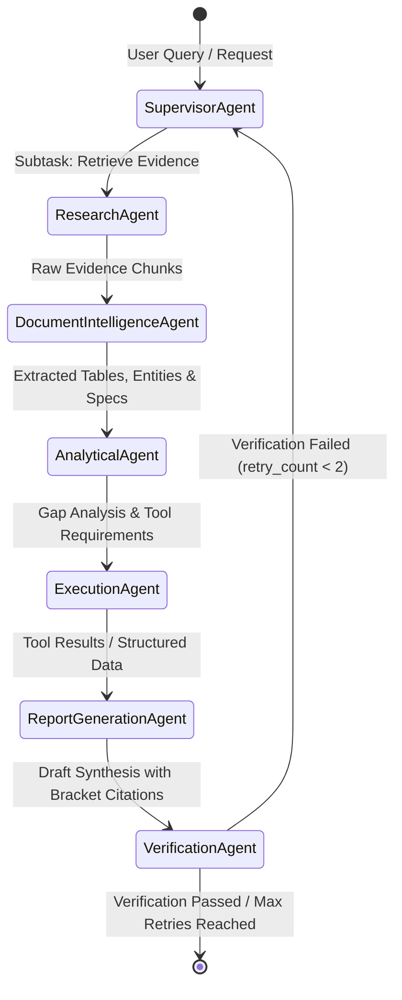

# AURA Multi-Agent Orchestration Architecture (LangGraph)

## 1. Overview

AURA coordinates 7 specialized AI agents using a compiled LangGraph `StateGraph`. Unlike brittle autonomous loops or simple chain-of-thought prompts, AURA's agent architecture guarantees:
- Deterministic state transitions through strongly typed state contracts.
- Granular subtask decomposition and tracking.
- Verification and hallucination detection before output reaches the user.
- Human-in-the-loop (HITL) checkpoints for high-risk actions.
- Automatic retry loop with maximum bounds ($N \le 2$) to eliminate infinite recursion.

---

## 2. Multi-Agent StateGraph Diagram



---

## 3. Agent Roster & Specializations

### 3.1 Supervisor Agent
- **Role**: Workflow Planner & Dispatcher.
- **Responsibilities**:
  - Analyzes the user's prompt or business workflow goal.
  - Decomposes complex goals into sequential subtasks.
  - Monitors subtask completion and synthesizes intermediate results.
  - Maintains the global plan state and handles replanning upon verification feedback.

### 3.2 Research Agent
- **Role**: Evidence Gathering & Retrieval Specialist.
- **Responsibilities**:
  - Interacts with the Hybrid RAG engine (dense vector + BM25).
  - Formulates search queries from subtask requirements.
  - Collects relevant document chunks and source citations.
  - Filters out irrelevant or duplicate source passages.

### 3.3 Document Intelligence Agent
- **Role**: Entity, Table & Structure Extractor.
- **Responsibilities**:
  - Parses tabular data from CSV and Excel chunks.
  - Identifies named entities (organizations, monetary amounts, SLA percentages, dates).
  - Extracts structured requirement clauses and contractual obligations.
  - Feeds normalized key-value data to downstream analytical agents.

### 3.4 Analytical Agent
- **Role**: Gap, Risk & Compliance Analyst.
- **Responsibilities**:
  - Compares extracted specifications against target requirements (e.g., PRD vs. test coverage).
  - Identifies contractual risks, compliance gaps, and financial discrepancies.
  - Computes qualitative risk scores (High / Medium / Low).
  - Produces structured comparison matrices.

### 3.5 Execution Agent
- **Role**: Tool Calling & Action Orchestrator.
- **Responsibilities**:
  - Connects to the Model Context Protocol (MCP) server.
  - Invokes authorized tools (e.g., `search_internal_knowledge`, `query_application_data`).
  - **Human-in-the-Loop Checkpoint**: If a tool action performs state changes or external API calls, pauses state and requests administrator approval before committing execution.

### 3.6 Report Generation Agent
- **Role**: Synthesis & Document Authoring.
- **Responsibilities**:
  - Formats analytical findings into publication-ready Markdown.
  - Generates executive summaries, finding tables, and risk matrices.
  - Attaches strict bracket citations (`[DocTitle: Page X]`, `[DocTitle: Sheet Y]`) to every factual assertion.

### 3.7 Verification Agent
- **Role**: Hallucination Guard & Citation Auditor.
- **Responsibilities**:
  - Audits the draft report generated by the Report Generation Agent.
  - Matches every factual statement against the retrieved evidence chunks.
  - Checks for hallucinated metrics, ungrounded claims, or missing citations.
  - **Routing Decision**:
    - If claims are verified: Sets `verification_passed = True` and completes the run.
    - If unverified claims exist and `retry_count < 2`: Increments `retry_count`, logs feedback, and routes back to the Supervisor Agent for evidence re-retrieval.
    - If `retry_count >= 2`: Emits a verified graceful fallback to ensure pipeline termination.

---

## 4. State Schema Contract

The shared state passed across all LangGraph nodes is defined as a strongly typed dictionary:

```python
class AgentState(TypedDict):
    workspace_id: str
    query: str
    plan: List[str]
    subtasks: List[Dict[str, Any]]
    current_subtask_index: int
    context_chunks: List[Dict[str, Any]]
    extracted_entities: List[Dict[str, Any]]
    analysis_results: Dict[str, Any]
    tool_calls: List[Dict[str, Any]]
    draft_response: str
    synthesized_answer: str
    citations: List[Dict[str, Any]]
    verification_passed: bool
    verification_feedback: str
    retry_count: int
    confidence: float
```

---

## 5. Infinite Loop Prevention & Determinism

In distributed multi-agent systems, conditional routing edges can cause infinite recursion if an agent repeatedly fails verification. AURA enforces mathematical determinism:

1. **Stateful Mutation in Node**: The `retry_count` is incremented inside the `VerificationAgent` node itself (ensuring state persistence across graph edges).
2. **Strict Guardrail**:
   $$\text{Next Node} = \begin{cases} \text{SupervisorAgent} & \text{if } \neg\text{verification\_passed} \land \text{retry\_count} < 2 \\ \text{END} & \text{otherwise} \end{cases}$$
3. **Graceful Grounded Fallback**: When retry limits are reached, the system emits a validated fallback report acknowledging insufficient source context rather than hanging or fabricating information.
