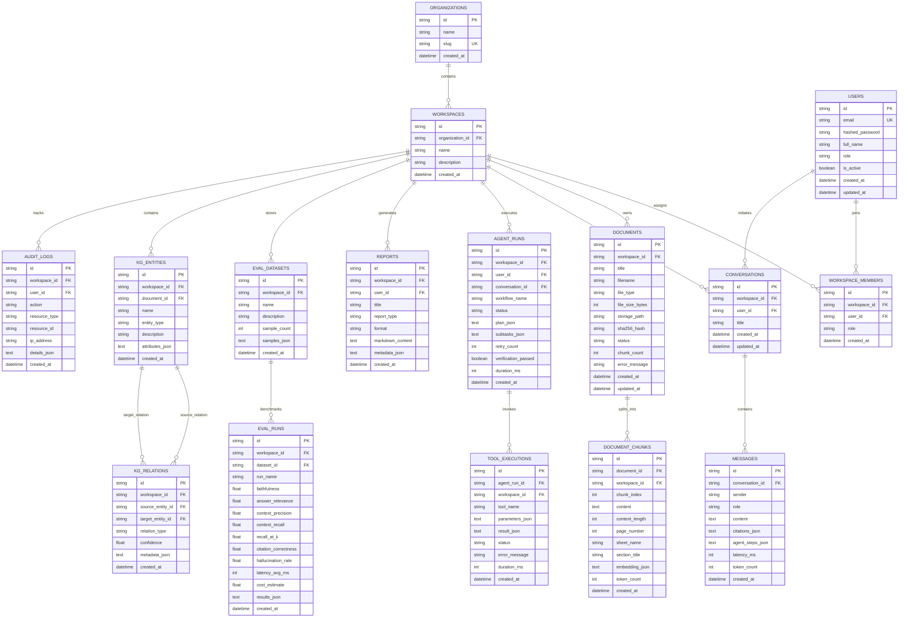

# AURA Database Schema & Entity Design

## 1. Relational Database Overview

AURA utilizes an asynchronous SQLAlchemy 2.0 relational architecture with multi-tenant workspace isolation.
- **Local / Development Database**: SQLite with JSON vector storage via `aiosqlite`.
- **Production Database**: PostgreSQL 16 with native `pgvector` extension for vector similarity search.
- **Migration Strategy**: Fully declarative schema models with automated initialization via `Base.metadata.create_all`.

---

## 2. Entity-Relationship Diagram (ERD)

---

## 3. Detailed Table Specifications

### 3.1 `documents` & `document_chunks`
- **Duplicate Prevention**: The `documents.sha256_hash` column is indexed. Before processing, an incoming file's hash is compared against the workspace's ingested documents.
- **Chunk Metadata**: Every `document_chunks` record stores `page_number` (for PDFs and Word documents), `sheet_name` (for Excel workbooks), and `section_title` (for structured HTML and Markdown).
- **Vector Storage**:
  - In SQLite: Stored as serialized JSON string in `embedding_json` (384 float dimensions).
  - In PostgreSQL: Mapped to `vector(384)` with an HNSW cosine similarity index.

### 3.2 `agent_runs` & `tool_executions`
- Records full execution traces for explainability and auditing.
- `plan_json` captures the initial task breakdown produced by the `SupervisorAgent`.
- `subtasks_json` tracks execution state for each subtask.
- `tool_executions` captures tool name, invocation arguments, execution duration, and output payload.

### 3.3 `eval_datasets` & `eval_runs`
- Benchmarking tables storing real evaluations across RAGAS and DeepEval criteria.
- Metrics recorded: `faithfulness`, `answer_relevance`, `context_precision`, `context_recall`, `recall_at_k`, `citation_correctness`, and `hallucination_rate`.

### 3.4 `kg_entities` & `kg_relations`
- Backs the interactive Knowledge Base graph visualizer.
- Supports entity types: `system`, `metric`, `clause`, `component`, `feature`, `risk`, `actor`.
- Relations store directed edges with strength/confidence scores.

---

## 4. Indexing & Optimization Strategy

1. **Foreign Key Indexes**: All foreign keys (`workspace_id`, `document_id`, `conversation_id`, `agent_run_id`, etc.) are indexed to ensure sub-millisecond multi-tenant lookups.
2. **Composite Indexes**:
   - `(workspace_id, status)` on `documents` for rapid filtering of processing vs. indexed documents.
   - `(workspace_id, action, created_at)` on `audit_logs` for activity tracking and audit reports.
3. **Deduplication Index**:
   - `(workspace_id, sha256_hash)` on `documents` with unique constraint enforcement.
