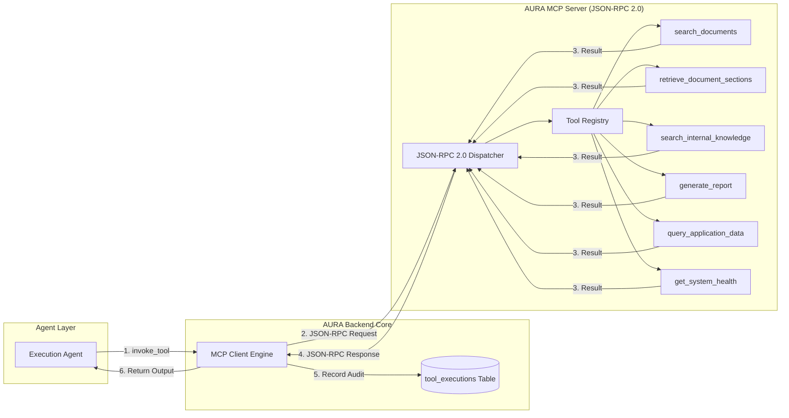

# AURA Model Context Protocol (MCP) Integration

## 1. Overview & Standard Compliance

AURA implements the open **Model Context Protocol (MCP)** specification, standardizing how AI agents discover, inspect, and execute tools and access external context.

The integration consists of two decoupled components:
1. **AURA MCP Server (`mcp-server/server.py` and `app/mcp/server.py`)**: An independent JSON-RPC 2.0 microservice running over stdio or HTTP/SSE, exposing registered enterprise tools.
2. **AURA MCP Client (`app/mcp/client.py`)**: An asynchronous client embedded in the AURA backend that validates JSON schemas, manages timeouts, handles retries, and audits tool executions into the database.



---

## 2. Registered MCP Tools Catalog

AURA registers 6 enterprise tools conforming to JSON Schema Draft 7:

### 2.1 `search_documents`
- **Purpose**: Semantic vector and keyword search across documents within an enterprise workspace.
- **Parameters**:
  - `query` (string, required): The search query string.
  - `workspace_id` (string, required): Target workspace ID.
  - `top_k` (integer, optional, default: 5): Maximum candidate chunks to retrieve.
- **Returns**: Array of matching document chunks with content, page/sheet numbers, and similarity scores.

### 2.2 `retrieve_document_sections`
- **Purpose**: Precise retrieval of sequential document sections or individual chunks by identifier.
- **Parameters**:
  - `document_id` (string, required): UUID of the document.
  - `start_chunk` (integer, optional, default: 0): Starting chunk index.
  - `limit` (integer, optional, default: 3): Number of chunks to return.
- **Returns**: Array of ordered chunk objects.

### 2.3 `search_internal_knowledge`
- **Purpose**: Query the enterprise Knowledge Graph for entities, attributes, and relationships.
- **Parameters**:
  - `entity_name` (string, required): Name or alias of the target entity.
  - `workspace_id` (string, required): Target workspace ID.
- **Returns**: Entity details, connected entities, and relation types.

### 2.4 `generate_report`
- **Purpose**: Triggers automated report compilation and persists the resulting Markdown report.
- **Parameters**:
  - `workspace_id` (string, required): Target workspace ID.
  - `title` (string, required): Title of the report.
  - `report_type` (string, required): Enum (`gap_analysis`, `financial_audit`, `contract_risk`, `executive_brief`).
- **Returns**: Created report ID and preview content.

### 2.5 `query_application_data`
- **Purpose**: Retrieves operational statistics, document counts, and workspace telemetry.
- **Parameters**:
  - `workspace_id` (string, required): Target workspace ID.
  - `metric_type` (string, required): Enum (`counts`, `usage`, `storage`).
- **Returns**: Real database telemetry object.

### 2.6 `get_system_health`
- **Purpose**: Health check and diagnostics for system components (DB, embedding engine, vector store, background tasks).
- **Parameters**: None.
- **Returns**: Component health statuses, uptime, and latency measurements.

---

## 3. Protocol Message Format

All interactions follow the standard JSON-RPC 2.0 wire format:

### Tool Discovery Request:
```json
{
  "jsonrpc": "2.0",
  "id": "req-001",
  "method": "tools/list",
  "params": {}
}
```

### Tool Discovery Response:
```json
{
  "jsonrpc": "2.0",
  "id": "req-001",
  "result": {
    "tools": [
      {
        "name": "search_documents",
        "description": "Semantic and keyword search over workspace documents",
        "inputSchema": {
          "type": "object",
          "properties": {
            "query": {"type": "string"},
            "workspace_id": {"type": "string"},
            "top_k": {"type": "integer", "default": 5}
          },
          "required": ["query", "workspace_id"]
        }
      }
    ]
  }
}
```

### Tool Invocation Request:
```json
{
  "jsonrpc": "2.0",
  "id": "req-002",
  "method": "tools/call",
  "params": {
    "name": "search_documents",
    "arguments": {
      "query": "SOC 2 Type II audit compliance status",
      "workspace_id": "ws-engineering-01",
      "top_k": 3
    }
  }
}
```

---

## 4. Security, Sandboxing & Audit Logging

1. **Schema Validation**: Every input is validated against the tool's JSON Schema before execution. Invalid parameter types are rejected immediately with a `400 Invalid Params` RPC error.
2. **Tenant Boundary Enforcement**: Tool calls must include a valid `workspace_id`. Tools cannot access documents or knowledge graph nodes belonging to another workspace.
3. **Audit Trails**: Every invocation generates an entry in the `tool_executions` table recording:
   - `tool_name`
   - `parameters_json`
   - `result_json` (or `error_message` on failure)
   - `duration_ms`
   - `status` (`success`, `failed`, `pending_approval`)
4. **Execution Timeout**: Client enforces a strict 30-second timeout per tool call to prevent hung background processes.
