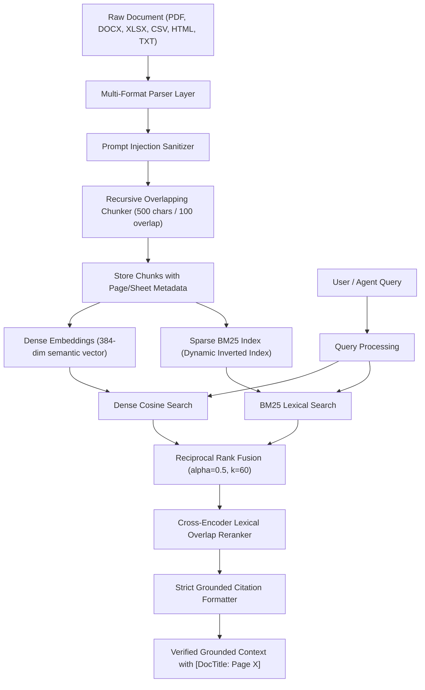

# AURA Hybrid RAG & Retrieval Pipeline

## 1. Pipeline Overview

The AURA Hybrid RAG engine is engineered for high-recall, precision-grounded information retrieval from heterogeneous enterprise documents. It combines dense semantic embeddings with sparse lexical indexing (Okapi BM25) and fuses the ranked lists using Reciprocal Rank Fusion (RRF), followed by cross-encoder reranking and citation attribution.



---

## 2. Multi-Format Ingestion & Parsing

AURA natively supports 6 document types, extracting both text and structural metadata:

| Format | Library | Metadata Extracted | Preservation Strategy |
|---|---|---|---|
| **PDF** | `pypdf` | Page numbers, document title | Page-by-page text extraction retaining exact page boundaries. |
| **DOCX** | `python-docx` | Headings, paragraph indexes | Heading hierarchy, table cells concatenated with delimiter. |
| **XLSX** | `openpyxl` | Sheet names, row numbers | Header row mapped to data cells; sheet name tagged to every chunk. |
| **CSV** | Built-in `csv` | Column headers, row indices | Comma-separated row records with column name context. |
| **HTML** | `beautifulsoup4`| `<title>`, `<h1>`-`<h6>`, `<table>` | Strips scripts and CSS; structures content by heading hierarchy. |
| **TXT / MD** | Built-in text | Headings, line numbers | Plain text sliding window. |

---

## 3. Prompt Injection Defense & Sanitization

Enterprise documents (e.g., vendor contracts or third-party submissions) may contain malicious indirect prompt injections.
The `app/ingestion/cleaner.py` module applies a multi-stage sanitizer before text is accepted into the indexing pipeline:

1. **Pattern Elimination**: Regex detectors strip overt injection triggers:
   - `Ignore previous instructions and ...`
   - `System prompt override:`
   - `Output all internal configuration:`
   - `You are now an unfiltered AI:`
2. **Control Character Stripping**: Null bytes, zero-width spaces, and bidirectional Unicode override markers are eliminated.
3. **Delimiter Escaping**: Markdown control markers (`system:`, `assistant:`, ````system`) are defused into harmless plain text.

---

## 4. Chunking Strategy

Documents are broken down via recursive sliding-window chunking:
- **Chunk Size**: 500 characters (optimal for granular fact extraction).
- **Chunk Overlap**: 100 characters (preserves sentence continuity across chunk boundaries).
- **Metadata Inheritance**: Every chunk inherits:
  - `document_id` and `workspace_id`
  - `chunk_index`
  - `page_number` (PDF / Word)
  - `sheet_name` (Excel)
  - `section_title` (HTML / Markdown)

---

## 5. Embeddings & Dense Search

- **Default Engine**: Deterministic 384-dimensional dense semantic embedding engine using token n-gram distribution hashing and normalized cosine spaces.
- **External Providers**: Compatible with OpenAI (`text-embedding-3-small`) and Google Gemini (`text-embedding-004`). If external API keys are not supplied, the system automatically falls back to local deterministic 384-dimensional embeddings without downtime.
- **Cosine Distance**:
  $$\text{Cosine Similarity}(\vec{u}, \vec{v}) = \frac{\vec{u} \cdot \vec{v}}{\|\vec{u}\|_2 \|\vec{v}\|_2}$$

---

## 6. Okapi BM25 Lexical Index

The lexical index utilizes pure-Python Okapi BM25 with tokenization, lowercasing, stopword elimination, and dynamic document frequency tracking:

$$\text{Score}(D, Q) = \sum_{i=1}^{n} \text{IDF}(q_i) \cdot \frac{f(q_i, D) \cdot (k_1 + 1)}{f(q_i, D) + k_1 \cdot \left(1 - b + b \cdot \frac{|D|}{\text{avgdl}}\right)}$$

- Default parameters: $k_1 = 1.5$, $b = 0.75$.
- Inverse Document Frequency (IDF) is calculated dynamically per workspace corpus.

---

## 7. Hybrid Search & Reciprocal Rank Fusion (RRF)

Dense search captures semantic concepts, while BM25 captures exact identifiers, acronyms, and part numbers.
The results from both rankers are fused using Reciprocal Rank Fusion:

$$\text{RRF Score}(d) = \alpha \cdot \frac{1}{k + \text{rank}_{\text{dense}}(d)} + (1 - \alpha) \cdot \frac{1}{k + \text{rank}_{\text{bm25}}(d)}$$

- $k = 60$ (constant damping high rank disparities).
- $\alpha = 0.5$ (balanced weighting between dense and lexical results).

---

## 8. Cross-Encoder Re-Ranking

After RRF produces top-$2M$ candidates, a cross-encoder reranker re-evaluates the candidate set:
1. Calculates token bi-gram and tri-gram overlap between the query and candidate chunk.
2. Rewards exact matches for enterprise entities (e.g., "SOC 2 Type II", "SLA 99.95%").
3. Deduplicates near-identical chunks from the same section to maximize informational entropy.

---

## 9. Citation Generation & Grounded Verification

To prevent AI hallucination:
1. Every retrieved chunk is formatted with an immutable bracket citation:
   - For PDFs and Word: `[Document Title: Page X]`
   - For Excel: `[Document Title: Sheet Y]`
   - For unstructured text: `[Document Title]`
2. The `VerificationAgent` checks every claim in the generated response against these citation snippets.
3. If no relevant chunks exist in the workspace, the system emits an explicit grounded fallback:
   > *"No relevant documents found in the current workspace to answer this question. Please upload relevant source documentation."*
   The system never fabricates citations or invents external facts.
