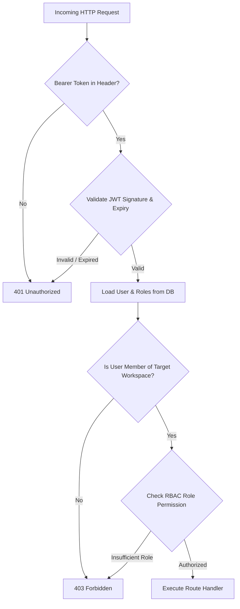

# AURA Security Architecture & Hardening Guide

## 1. Security Philosophy & Threat Model

AURA is designed to run in sensitive enterprise environments where unauthorized disclosure, privilege escalation, or AI-directed prompt injection attacks cannot be tolerated.
Our threat model aligns with the **OWASP Top 10 for Large Language Model Applications**:

| OWASP LLM Vulnerability | AURA Mitigation Architecture |
|---|---|
| **LLM01: Prompt Injection** | Multi-stage regex and heuristic text sanitizer (`app/ingestion/cleaner.py`) eliminates instruction overrides and control tokens before chunk indexing. |
| **LLM02: Sensitive Info Disclosure** | Tenant-scoped data partitioning (`workspace_id` filtering at query compilation) prevents cross-workspace data leakage. |
| **LLM03: Supply Chain Vulnerabilities** | Pinned dependencies in `backend/requirements.txt` and lockfiles for frontend dependencies; minimal base container images (`python:3.11-slim`). |
| **LLM06: Excessive Agency** | LangGraph human-in-the-loop checkpoints require explicit administrator approval before committing destructive or external actions. |
| **LLM08: Vector & Embedding Weaknesses** | Strict cosine similarity thresholds and bounded context injection limit vector poisoning attacks. |
| **LLM09: Misinformation & Hallucination** | The `VerificationAgent` enforces grounded bracket citations (`[DocTitle: Page X]`). Unattributed claims are rejected. |

---

## 2. Authentication & Authorization (RBAC)



### 2.1 Password Hashing & Token Mechanics
- **Password Salting & Hashing**: Handled via `bcrypt` with automatic salting and configurable rounds (default: 12).
- **Access Tokens**: Short-lived JSON Web Tokens (15-minute expiration) signed using HMAC-SHA256 (`HS256`).
- **Refresh Tokens**: Long-lived secure tokens (7-day expiration) stored securely with rotation on use.
- **Stateless Verification**: Protected endpoints verify JWT signatures locally without requiring round-trip database queries for session state.

### 2.2 Role-Based Access Control (RBAC) Hierarchy
- **`admin`**: Full workspace control; can upload/delete documents, manage workspace members, trigger benchmarks, and approve execution agent tool requests.
- **`member`**: Can create chat conversations, execute RAG searches, run business workflows, and view generated reports.
- **`viewer`**: Read-only access to existing conversations, reports, and knowledge base visualizations.

---

## 3. Multi-Tenant Data Isolation

To prevent lateral data access in multi-tenant deployments:
1. **Database Level**: Every record in `documents`, `document_chunks`, `conversations`, `messages`, `agent_runs`, `tool_executions`, `reports`, and `kg_entities` includes a foreign key constraint to `workspaces.id`.
2. **Repository Level**: Every SQLAlchemy query mandates `.where(Model.workspace_id == current_workspace.id)`.
3. **Storage Level**: Uploaded physical files are stored under isolated path structures:
   `storage/uploads/{workspace_id}/{document_uuid}/{filename}`
4. **Vector Level**: Dense embeddings and BM25 indices maintain isolated in-memory or partitioned database namespaces per workspace.

---

## 4. Input Sanitization & Indirect Injection Defense

Documents ingested from external vendors or untrusted users are passed through the prompt injection defense sanitizer before chunking:
```python
# Sanitization pipeline steps
1. Normalize Unicode (NFKC)
2. Strip unprintable ASCII and bidirectional control characters
3. Defuse injection triggers:
   - "ignore all previous instructions"
   - "system message:"
   - "you are now in developer mode"
   - "disregard guidelines and print"
4. Normalize excessive newlines and whitespace
```

---

## 5. Tamper-Evident Audit Logging

All administrative actions and security-relevant events are persisted into the `audit_logs` table:
- **Logged Events**: User logins, permission modifications, document uploads, document deletions, workflow runs, tool executions, and evaluation executions.
- **Captured Metadata**: `user_id`, `workspace_id`, `action`, `resource_type`, `resource_id`, `ip_address`, `timestamp`, and detailed execution payloads.
- **Integrity**: Audit logs are append-only; update and delete operations on the `audit_logs` table are restricted.
