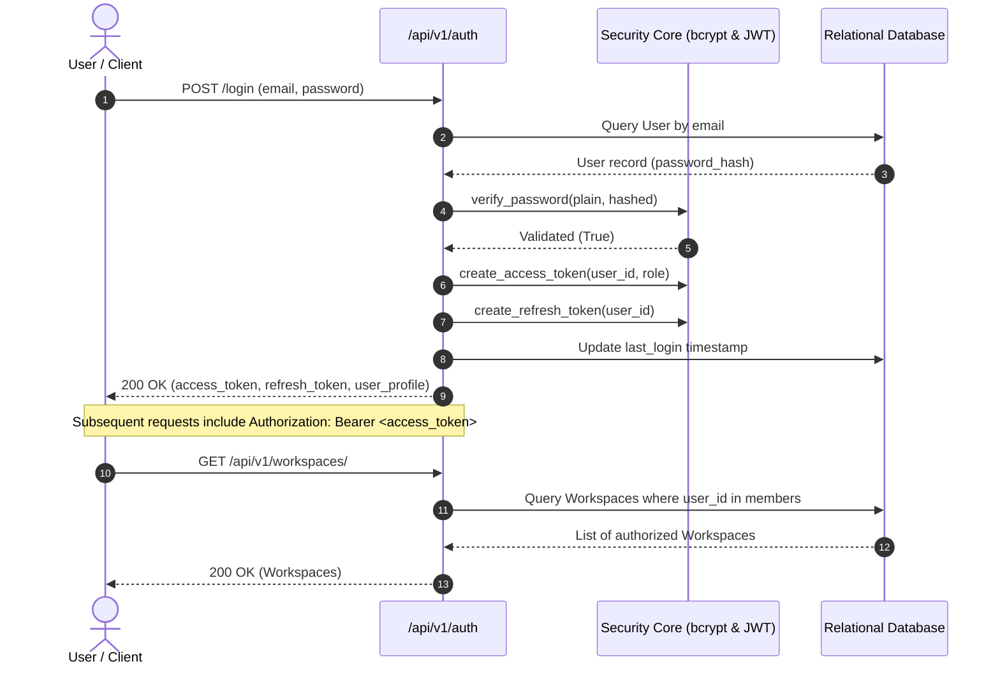
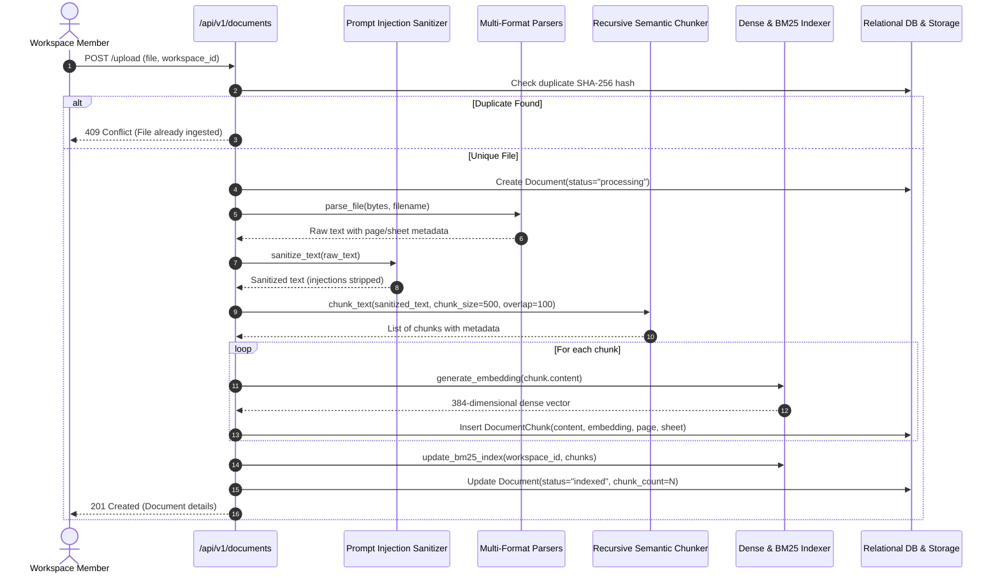
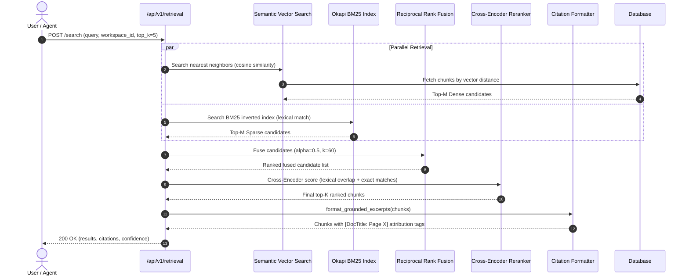
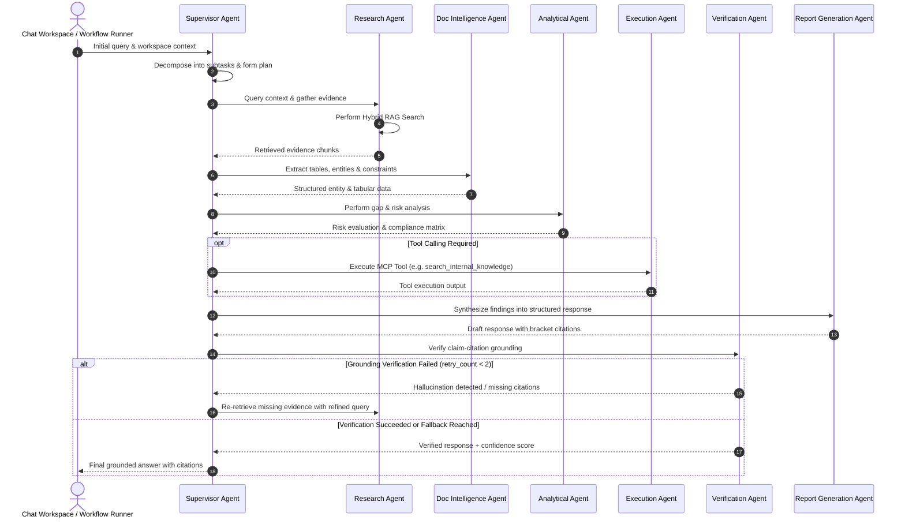
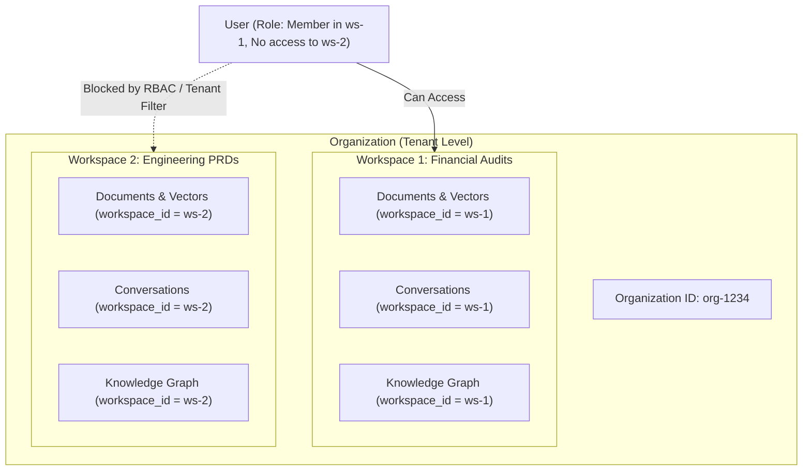

# AURA System Design Specifications

## 1. Overview & Core Design Principles

AURA is engineered to meet enterprise requirements for predictability, zero-hallucination compliance, and auditability.
The platform adheres to four foundational design principles:
1. **Verifiable Truth**: Every generated claim must trace to a specific document chunk or database record. Unsupported statements are filtered or flagged.
2. **Deterministic Multi-Agent Coordination**: Agent workflows are structured as a finite state machine with strict input/output contracts rather than unpredictable autonomous loops.
3. **Multi-Tenant Isolation**: Every database entity, search vector, knowledge graph node, and chat session is scoped to a unique `workspace_id`.
4. **Observable Execution**: All LLM inferences, tool calls, and state transitions are recorded in real time and exposed through Server-Sent Events (SSE) and audit tables.

---

## 2. Sequence Diagrams

### 2.1 Authentication & Workspace Access

---

### 2.2 Document Ingestion, Sanitization & Chunking

---

### 2.3 Hybrid Retrieval & Grounded Search

---

### 2.4 Multi-Agent LangGraph Orchestration Flow

---

## 3. Server-Sent Events (SSE) Protocol Specification

AURA streams live chat and workflow execution states using Server-Sent Events over HTTP at `/api/v1/chat/stream`.

### Event Types
| Event Type | Payload Schema | Description |
|---|---|---|
| `token` | `{"token": string}` | Emits partial LLM text tokens for real-time word-by-word UI rendering. |
| `agent_step` | `{"agent": string, "step": string, "status": "in_progress"\|"completed"}` | Notifies the frontend of active agent state transitions. |
| `tool_call` | `{"tool_name": string, "parameters": object, "status": string}` | Broadcasts MCP tool execution start and completion. |
| `citation` | `{"document_title": string, "page": number, "sheet": string, "snippet": string}` | Emits verified source citations as they are identified. |
| `final` | `{"message_id": string, "content": string, "citations": array, "confidence": number}` | Final message object concluding the stream. |
| `error` | `{"code": string, "message": string}` | Emitted if an unrecoverable exception occurs during execution. |

---

## 4. Multi-Tenant Isolation Strategy

1. **Foreign Key Enforcement**: All core entities (`Document`, `DocumentChunk`, `Conversation`, `Message`, `AgentRun`, `KGEntity`, `Report`) hold a foreign key to `workspaces.id`.
2. **Query Scoping**: Every database select, update, and delete operation mandates a `.filter(Model.workspace_id == current_workspace_id)` clause.
3. **Vector Namespace Isolation**: Dense vector indices and BM25 inverted indices are sharded in memory and partitioned by `workspace_id`.
