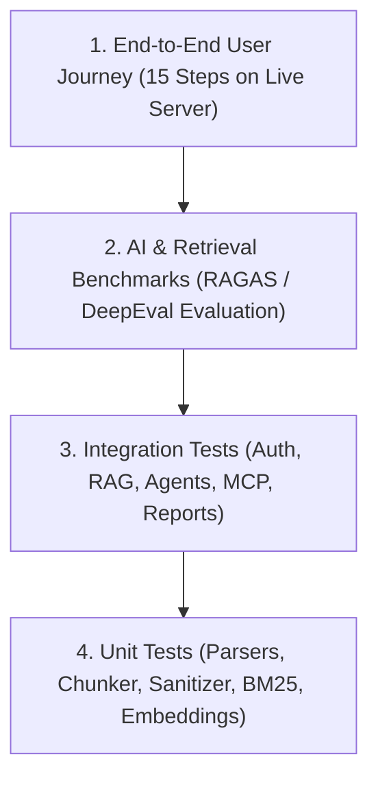

# AURA Testing & QA Strategy

## 1. Testing Philosophy & Quality Gate

AURA employs a multi-tiered Quality Assurance methodology to ensure enterprise reliability across all subsystems.
Software is never deemed complete based solely on build success or UI responsiveness. Every functional capability is validated through:
1. **Automated Unit & Subsystem Tests** (`pytest`)
2. **Multi-Agent Orchestration & Determinism Tests**
3. **End-to-End User Journey Automation** (`scripts/run_e2e_journey.py`)
4. **AI Retrieval & Hallucination Benchmarks** (RAGAS / DeepEval metrics)
5. **Frontend Production Type Checking & Compilation** (`npm run build`)

---

## 2. Test Pyramid & Execution Matrix



| Test Suite | File Location | Target Subsystem | Assertions Verified |
|---|---|---|---|
| **Authentication** | `backend/tests/test_auth.py` | JWT, bcrypt, RBAC | User creation, duplicate prevention, password matching, invalid token rejection. |
| **Documents & Parsers** | `backend/tests/test_documents.py` | Multi-format parsers, Chunker | PDF, DOCX, XLSX, CSV, HTML, TXT extraction, deduplication via SHA-256. |
| **Hybrid RAG** | `backend/tests/test_rag.py` | BM25, Dense search, RRF | Tokenizer, inverted index, cosine similarity, reciprocal rank fusion, citations. |
| **Multi-Agent Graph** | `backend/tests/test_agents.py` | LangGraph StateGraph | 7 agent nodes, subtask state transitions, verification retry bounds, fallback. |
| **MCP Integration** | `backend/tests/test_mcp.py` | Model Context Protocol | Tool discovery (`tools/list`), tool calling (`tools/call`), audit logging. |
| **Report Generation** | `backend/tests/test_reports.py` | Report Service | Markdown compilation, executive summary, findings, export endpoint. |
| **Evaluations** | `backend/tests/test_evaluations.py` | RAGAS & DeepEval metrics | Faithfulness, context recall/precision, hallucination rate calculations. |

---

## 3. Automated Test Execution Commands

### Run Complete Pytest Suite:
```powershell
$env:PYTHONPATH="backend"
.\.venv\Scripts\python.exe -m pytest backend/tests -v
```

### Run Specific Test Modules:
```powershell
# Run Authentication tests
.\.venv\Scripts\python.exe -m pytest backend/tests/test_auth.py -v

# Run RAG & Citation tests
.\.venv\Scripts\python.exe -m pytest backend/tests/test_rag.py -v

# Run LangGraph Agent tests
.\.venv\Scripts\python.exe -m pytest backend/tests/test_agents.py -v
```

---

## 4. End-to-End (E2E) User Journey Verification

The E2E test script (`scripts/run_e2e_journey.py`) tests the complete enterprise user journey against the live running API:

1. **Step 1: System Health Verification**: Probes `/health` for database connectivity.
2. **Step 2: User Registration**: Registers a unique enterprise user account.
3. **Step 3: User Authentication**: Performs login and receives JWT access/refresh tokens.
4. **Step 4: Workspace Provisioning**: Creates an enterprise workspace for document isolation.
5. **Step 5: Multi-Format Document Ingestion**:
   - Uploads Markdown PRD (`datasets/sample_prd.md`).
   - Uploads Test Coverage Matrix (`datasets/sample_test_coverage.csv`).
   - Uploads Financials (`datasets/sample_financials.csv`).
   - Uploads Legal Contract (`datasets/sample_contract.txt`).
   - Uploads Architecture HTML (`datasets/sample_architecture.html`).
   - Uploads Word Document (`datasets/sample_prd.docx`).
   - Uploads Excel Spreadsheet (`datasets/sample_financials.xlsx`).
6. **Step 6: Document Processing & Chunk Verification**: Confirms status is `indexed` and chunks have metadata.
7. **Step 7: Hybrid RAG Search**: Executes query against ingested corpus, validating RRF and citations.
8. **Step 8: Grounded Citation Validation**: Ensures citations reference `[DocTitle: Page X]` or `[DocTitle: Sheet Y]`.
9. **Step 9: Knowledge Graph Query**: Queries extracted entities and relationships.
10. **Step 10: Multi-Agent Orchestration**: Dispatches 7-agent LangGraph workflow.
11. **Step 11: MCP Tool Discovery & Calling**: Dispatches `tools/list` and executes `search_documents`.
12. **Step 12: Business Workflow Execution**: Executes PRD Gap Analysis workflow.
13. **Step 13: Report Generation & Export**: Synthesizes and downloads Markdown report.
14. **Step 14: Evaluation Benchmark Run**: Runs RAGAS evaluation metrics.
15. **Step 15: Database Analytics Verification**: Validates real calculated metrics from database.

### Run E2E Test:
```powershell
.\.venv\Scripts\python.exe scripts/run_e2e_journey.py
```

---

## 5. Continuous Integration (CI) Pipeline

A GitHub Actions workflow is established in `.github/workflows/ci.yml`:
- **Backend Job**: Sets up Python 3.11, installs dependencies, runs linter, and executes the full pytest suite.
- **Frontend Job**: Sets up Node.js 20, installs npm dependencies, and runs `npm run build` to verify zero TypeScript errors and complete bundle production.
